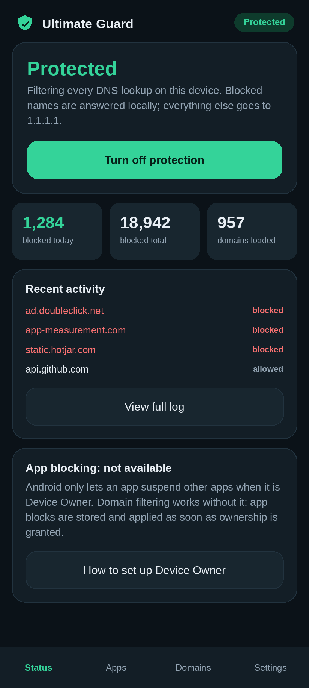
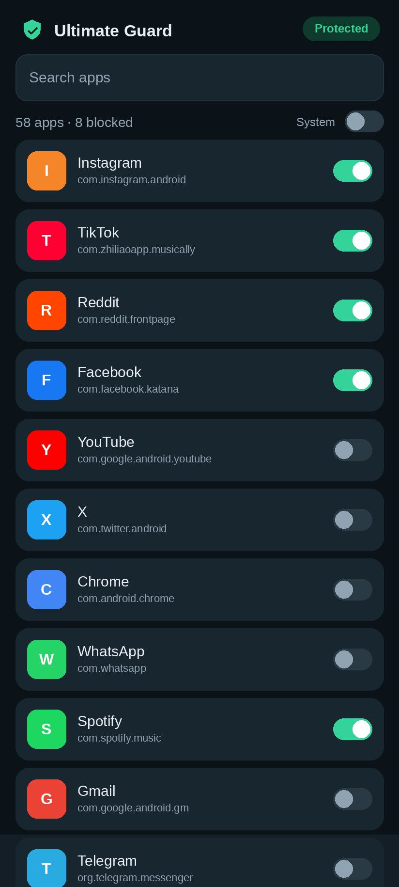
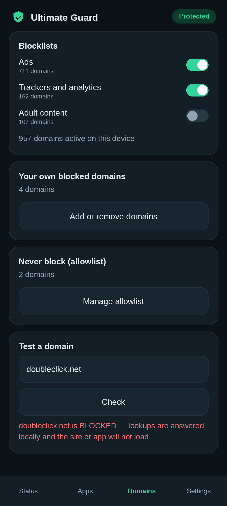
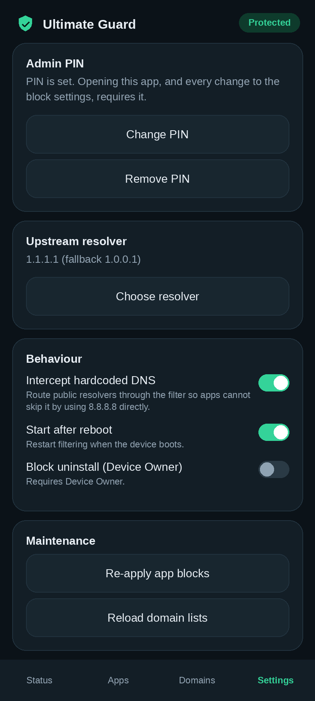

# Ultimate Guard 1.0

An offline DNS filter for Android. It answers blocked domains locally so the
app or site never resolves, and forwards everything else to the resolver you
choose. Optional Device Owner support lets it suspend apps as well.

<p align="center">
  
  
  
  
</p>

**[⬇ Download the signed APK](https://github.com/technicalnihilist-lgtm/ultimate-guard/releases/latest)** · `dist/UltimateGuard-1.0.0.apk` is also in the repo.

> The screenshots above are UI previews rendered from the app's layout files and design
> tokens (same colours, spacing and strings as the running app). The APK itself was
> compiled and signed here, but not run on a physical device or emulator.

Built with the Android framework only — no third-party libraries, no accounts,
no servers, no telemetry. minSdk 26, targetSdk 35.

## What actually works

- **A real DNS filtering engine.** A local `VpnService` tunnel parses IPv4 and
  IPv6 packets, decodes DNS queries, and either answers them itself (blocked
  names get `0.0.0.0` / `::`) or forwards them upstream and wraps the reply
  back into a correct IP/UDP packet with recomputed checksums.
- **Subdomain matching.** Blocking `doubleclick.net` blocks `ad.g.doubleclick.net`
  too, via a parent-domain walk, not a substring match.
- **Hardcoded-DNS interception.** The well-known public resolver addresses are
  routed into the tunnel, so an app that talks to `8.8.8.8` directly is still
  filtered (and its DoH/DoT attempts to those addresses are dropped).
- **3 blocklists + your own.** 711 ad domains, 162 tracker domains and 107
  adult domains are bundled (957 unique after de-duplication); add your own domains, an allowlist, or import any
  hosts-file / Adblock-style text file.
- **App blocking via Device Owner.** Selected apps are suspended with
  `DevicePolicyManager`, re-applied on boot and when a package is reinstalled.
- **PIN lock.** The whole UI is behind a salted PBKDF2 PIN, so the block
  settings cannot be changed by someone else holding the phone.
- **Live stats and a rolling activity log**, kept on the device.

## Install

```
adb install -r UltimateGuard-1.0.0.apk
```

Or copy the APK to the phone and tap it (allow "install unknown apps" for your
file manager first). Then:

1. Open the app and set a PIN.
2. Tap **Turn on protection** and accept Android's VPN prompt.
3. Optional: Settings → Network → VPN → Ultimate Guard → enable **Always-on VPN**
   so filtering survives reboots and app kills.

## Optional: Device Owner (for app blocking)

Android only lets an app suspend other apps if it is Device Owner, which
requires a device with no accounts, set up fresh:

```
adb shell dpm set-device-owner com.ultimateguard/.GuardAdminReceiver
```

Use a spare phone or an emulator. Removing Device Owner requires a factory
reset. Without Device Owner the app still filters DNS normally; app blocks are
stored and applied the moment ownership is granted.

## How it works

```
 app  ──DNS query──▶  10.111.222.2:53 (inside the tunnel)
                              │
                    FilteringVpnService
                              │
                 ┌────────────┴────────────┐
         name is blocked            name is allowed
                 │                         │
      answer 0.0.0.0 / ::        forward to upstream resolver
      (no network round trip)     (Cloudflare / Google / Quad9 / custom)
```

- The tunnel carries DNS only, plus the public resolver `/32`s when
  interception is on. All other traffic keeps using the normal network path,
  so there is no full-tunnel battery cost.
- Blocked `A` queries get `0.0.0.0`, `AAAA` gets `::`, other types get a
  NOERROR/NODATA answer — the client fails fast instead of retrying other
  resolvers.
- Upstream lookups run on a thread pool with a 3 s timeout, a fallback
  resolver, and a 30 s response cache.

## Layout

```
app/src/main/java/com/ultimateguard/
  core/DnsPacket.kt      DNS message parse/build (pure JVM, unit-tested)
  core/IpPacket.kt       IPv4/IPv6 + UDP parse/build, checksums (pure JVM)
  core/DomainMatcher.kt  suffix matching + whitelist (pure JVM)
  core/DnsEngine.kt      TUN read loop, block/forward decisions, cache
  core/BlocklistRepository.kt   assets + user lists + import
  core/Admin.kt          DevicePolicyManager wrapper (suspend, uninstall block)
  core/BlockStore.kt     append-only registry of blocked packages
  core/Prefs.kt, PinStore.kt, GuardState.kt, RecentLog.kt, AppInventory.kt
  FilteringVpnService.kt foreground VPN service
  MainActivity.kt        tabs + PIN gate
  ui/                    the four screens
```

## Tests

The packet engine and matcher are pure JVM code and are tested without a device:

```
./tools/run-tests.sh     # engine assertions + blocklist sanity checks
```

## Build from source

**Android Studio** — open the folder, JDK 17, AGP 8.7.3 / Kotlin 2.0.21, build
the `app` module.

**Command line** (`build.sh`, used to produce the APK here) — needs JDK 17, a
Kotlin compiler and Android SDK 35 in `PATH`/`ANDROID_HOME`; runs aapt2 → javac
(R.java) → kotlinc → d8 → zipalign → apksigner.

## Limits — read these

- **DNS is not a firewall.** An app that uses its own encrypted DNS (DoH/DoT)
  pointed at a server this app does not intercept can still resolve names.
  Blocking every DoH server would require a full-tunnel TCP relay.
- Ads served from the same domain as the content, and ads baked into app
  assets, cannot be blocked at the DNS level.
- Only one VPN can be active at a time; another VPN app will take the tunnel.
- The bundled lists are curated starter lists, not exhaustive ones. Import a
  bigger list you trust if you need broader coverage.
- App suspension needs Device Owner, and some system packages cannot be
  suspended. Never block Settings, System UI, Phone, or the installer.
- Nothing here survives a factory reset, and someone with recovery or ADB
  access can bypass it. This is a self-control and family-safety tool, not
  tamper-proof lockdown.
